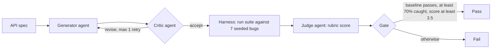

# Pankaj Pandey

**QA engineer building AI-assisted test tooling.** I work on lending and banking platforms: API regression, accounting checks and production root-cause analysis. In my own time I build tools that make AI-written tests prove their value.

> I'd rather show a seeded bug being caught than a coverage percentage.

---

### Featured: ai-test-case-generator

Three Claude agents write a pytest suite from an API spec. A reference app with **7 named, seeded bugs** (auth bypass, data leak, idempotency violation, …) then checks whether that suite actually catches them.

No agent framework: the orchestration is a single ~40-line function with typed contracts at every step. CI runs the full suite against a fake LLM client, so it costs nothing and never flakes. A live run costs about $0.11. → [Read the repo](https://github.com/PankajPandey-codes/ai-test-case-generator)

---

### More tools

<table>
<tr>
<td width="50%" valign="top">

**[flowforge](https://github.com/PankajPandey-codes/flowforge)** 
Records real browser traffic and turns it into API test fixtures. Sensitive values are masked before anything reaches an LLM. 
Python · mitmproxy · Flask

</td>
<td width="50%" valign="top">

**[java-regression-runner](https://github.com/PankajPandey-codes/java-regression-runner)** 
CSV/JSON-manifest API regression runner with step chaining, SQL steps, HTML reports and unattended overnight runs. 
Java 17 · JUnit · SQL

</td>
</tr>
<tr>
<td width="50%" valign="top">

**[iris](https://github.com/PankajPandey-codes/iris)** 
Native macOS API console with collections, environments, request tests and a CSV batch runner. 
Python · pywebview · JavaScript

</td>
<td width="50%" valign="top">

**[pagewright](https://github.com/PankajPandey-codes/pagewright)** 
Desktop PDF editor: edit existing text, add text, images and shapes, merge and split. 
Java · Swing · PDFBox

</td>
</tr>
</table>

Also: [riggr](https://github.com/PankajPandey-codes/riggr), an agent-harness toolkit adapted from the MIT-licensed [affaan-m/ECC](https://github.com/affaan-m/ECC), with attribution retained.

---

### How I build

- **A test suite is only as good as the bugs it catches.** I measure that with seeded bugs, not coverage.
- **Honest scope.** Each README says what is out of scope and where the tool stops.
- **Local-first.** No hosted service needed; the LLM-backed tools use your own API key.

### Toolbox

  

pytest · JUnit · mitmproxy · JMeter · Claude API · Claude Code
