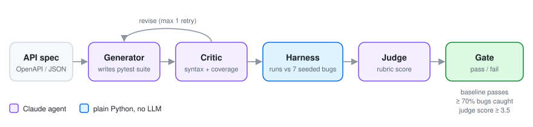
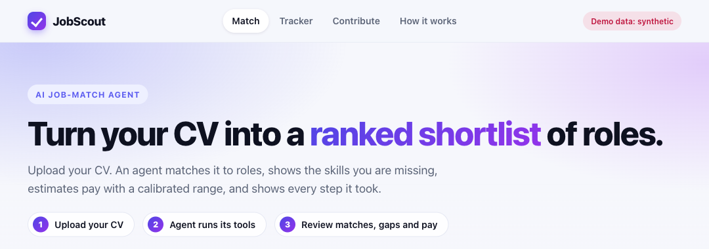

  

### 👋 In 30 seconds

- 🏦 **By day:** QA engineer on lending and banking platforms: API regression, ledger and accounting checks, production root-cause analysis.
- 🤖 **By night:** I build agent pipelines that **write** API tests and then **audit** them against seeded bugs.
- 🎯 **My rule:** a test suite is worth the bugs it catches, not the coverage it reports.

---

## ⭐ Featured · [ai-test-case-generator](https://github.com/PankajPandey-codes/ai-test-case-generator)

Three Claude agents turn an API spec into a pytest suite. A reference app with **7 named, seeded bugs** (auth bypass, data leak, idempotency violation, …) then checks whether that suite actually catches them.

| 🐞 Seeded bugs | 🧩 Orchestration | 💸 Live run | ✅ CI |
|:---:|:---:|:---:|:---:|
| **7** named | **~40 lines**, no framework | **≈ $0.11** | fake LLM, **$0**, no flakes |

---

## 🛠️ Tools I've built

<table>
<tr>
<td colspan="2" valign="top">

### 🔎 [jobscout](https://github.com/PankajPandey-codes/jobscout): an AI job-match agent
Upload a CV, get ranked roles, skill gaps and a calibrated salary range, with every agent step visible.

 

</td>
</tr>
<tr>
<td width="50%" valign="top">

### 🌊 [flowforge](https://github.com/PankajPandey-codes/flowforge)
Records real browser traffic and turns it into API test fixtures. Sensitive values are masked **before** anything reaches an LLM.

  

</td>
<td width="50%" valign="top">

### ☕ [java-regression-runner](https://github.com/PankajPandey-codes/java-regression-runner)
API regression from CSV/JSON manifests: step chaining, SQL steps, HTML reports, unattended overnight runs.

  

</td>
</tr>
<tr>
<td width="50%" valign="top">

### 🧪 [iris](https://github.com/PankajPandey-codes/iris)
Native macOS API console: collections, environments, request tests and a CSV batch runner.

  

</td>
<td width="50%" valign="top">

### 📄 [pagewright](https://github.com/PankajPandey-codes/pagewright)
Desktop PDF editor: edit existing text, add images and shapes, merge and split.

  

</td>
</tr>
</table>

---

## 🤖 How I use AI, and how I check it

I build with Claude Code, and I don't take its output on trust:

| I don't trust… | So I… |
|---|---|
| "The tests pass" | Seed known bugs and measure how many the suite catches |
| "The agent is done" | Put a Critic and a Judge agent behind every Generator |
| "It works on my key" | Run CI against a fake LLM so every check is free and repeatable |
| "It handles data safely" | Mask sensitive values before any prompt leaves the machine |

---

## 🧰 Toolbox

 

---

**Working on AI-assisted testing too? I'd like to compare notes.**

