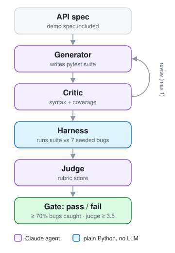

 

I test lending and banking platforms: API regression, accounting checks and production root-cause analysis. Outside work, I build tools that make **AI-written tests prove they catch real bugs**.

> A test suite is worth the bugs it catches, not the coverage it reports.

## Spotlight: [ai-test-case-generator](https://github.com/PankajPandey-codes/ai-test-case-generator)

Three Claude agents turn an API spec into a pytest suite. A reference app with **7 named, seeded bugs** (auth bypass, data leak, idempotency violation, …) then checks whether that suite actually catches them.

**7** seeded bugs &nbsp;·&nbsp; **~40-line** orchestrator, no framework &nbsp;·&nbsp; **≈ $0.11** per live run &nbsp;·&nbsp; **$0** CI on a fake LLM

**[Read the repo →](https://github.com/PankajPandey-codes/ai-test-case-generator)**

## More tools

**[flowforge](https://github.com/PankajPandey-codes/flowforge)**: turns recorded browser traffic into API test fixtures. Sensitive values are masked **before** anything reaches an LLM. 
Python · mitmproxy · Flask

**[iris](https://github.com/PankajPandey-codes/iris)**: native macOS API console with collections, environments, request tests and a CSV batch runner. 
Python · pywebview · JavaScript

**[pagewright](https://github.com/PankajPandey-codes/pagewright)**: desktop PDF editor. Edit existing text, add images and shapes, merge and split. 
Java · Swing · PDFBox

## How I check AI output

I build with Claude Code and verify what it produces:

- **"The tests pass" isn't proof.** I seed known bugs and count how many the suite catches.
- **"The agent is done" isn't proof.** A Critic and a Judge agent review every Generator.
- **Checks must be repeatable.** CI runs against a fake LLM, so it is free and never flakes.
- **Data stays safe.** Sensitive values are masked before any prompt leaves the machine.

## Toolbox

